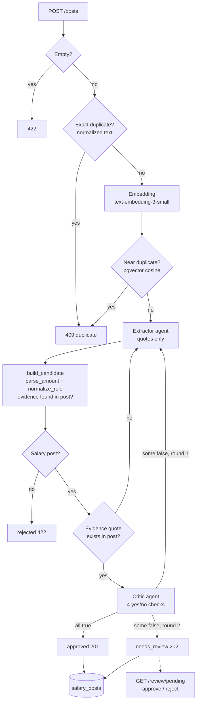
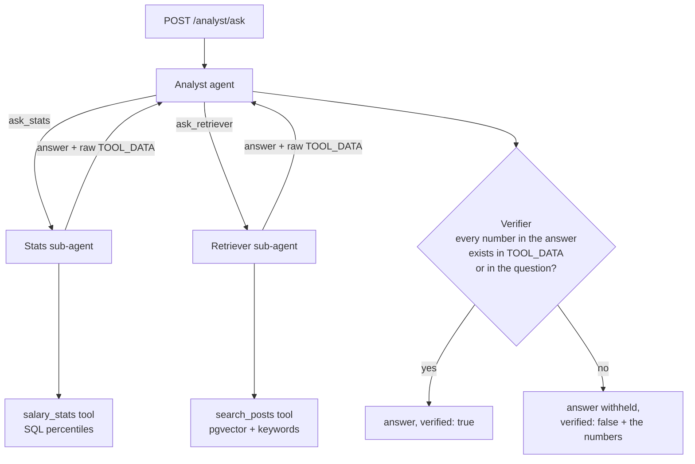

# Salary Intel

Salary intelligence for the Israeli tech market, built from community salary posts written in Hebrew.

Two things in one backend:

1. **A RAG question-answering endpoint** that retrieves relevant posts and answers from them (`/query`).
2. **A multi-agent pipeline** that turns raw posts into clean, reviewable salary records, and an **Analyst agent** whose numbers are checked by deterministic code before a user sees them.

```text
Query:  "כמה מרוויח DevOps עם 5 שנות ניסיון?"
Answer: "מהנדס DevOps עם 5 שנות ניסיון מרוויח בין 45,000₪ ל-55,000₪..."
```

## The design rule

> The model reads and decides. Code does the arithmetic and the checking.

Every place where a wrong number would hurt is handled by plain, tested Python instead of a model:

| Job | Who does it | Why |
|---|---|---|
| Find the salary phrase and the job title in a post | LLM (`Extractor`) | Free-form Hebrew text |
| Turn "62 א׳ ברוטו" into `62000`, gross | Code (`parse_amount`) | A model must never "compute" a salary |
| Map a title to one of 14 roles | Code (`normalize_role`) | Closed list, repeatable |
| Percentiles (p25/p50/p75) | SQL `percentile_cont` | Exact, no sampling noise |
| Check the extraction against the post | LLM (`Critic`), answering four yes/no questions | Needs reading the post |
| Decide approved / needs review | Code (`review_loop`) | The model cannot approve itself |
| Check that every number in an answer exists in the tool output | Code (`Verifier`) | Catches invented numbers |

## Architecture

### Ingestion: from a raw post to a record



* The `Extractor` only copies text. It never produces a number.
* A post is retried at most twice, with the `Critic`'s issues passed back as feedback.
* Only `approved` rows are visible to `/query`, the statistics tool and the Analyst.
* Rejecting a pending post marks it `rejected`; nothing is deleted.

### Answering: the Analyst



* A sub-agent is a `create_agent` wrapped in an `@tool`. The Analyst sees a tool with a name and a description.
* Each wrapper returns the model's text **and** the raw tool output, so the `Verifier` compares the answer against evidence the model cannot edit.
* If verification fails, the answer is not returned at all. A wrong salary figure is worse than no figure.

### Retrieval (`/query`)

```text
query -> embedding + LLM query expansion (in parallel)
      -> hybrid search: semantic (pgvector) + weighted keywords
      -> Reciprocal Rank Fusion
      -> LLM rerank (top 3)
      -> grounded answer + sources
```

Retrieval latency dropped from about 5.0s to 1.9s (-62%) by running the embedding and the query expansion with `asyncio.gather`. Per-stage latency and estimated cost are stored per request in `query_logs`.

## Measured results

All numbers below come from running the code in this repository against `gpt-4o-mini` (`temperature=0`). The scripts and raw outputs are in [`backend/evals/`](backend/evals/).

### Does the Critic improve the pipeline? (`python -m evals.run_ablation`)

39 labeled posts (Hebrew, written by me), the full review loop run with and without the `Critic`:

| | Without Critic | With Critic |
|---|---|---|
| Approved automatically | 34 | 31 |
| Sent to human review | 0 | 3 (all false alarms) |
| Rejected as not a salary post | 5 | 5 |
| Wrong records admitted | 0 | 0 |
| Average time per post | 0.96s | 2.17s |

**Honest reading:** on this set the `Extractor` is already correct on all 39 posts, because the numbers come from code and the model only copies phrases. So the `Critic` has nothing to catch here, and it costs about 2x latency and 3 extra reviews. This set cannot show a benefit; it shows the `Extractor` design is solid.

Two earlier versions of the `Critic` are kept in `evals/results/` because they taught something:

* The original prompt (`ablation_v1_original_prompt.json`) demanded a second offer that the pipeline deliberately drops, and sent 12 of 31 correct posts to review.
* A free-text `issues` version (`ablation_v2_free_text_critic.json`) sent 21 correct posts to review and, worse, its feedback made the `Extractor` change 5 correct answers into wrong ones. The model was marking `agrees: false` while writing "the pay basis is correct" in `issues`.
* The fix was structural: the `Critic` now answers four yes/no questions and code derives `agrees` and the feedback text.

### Can the Critic catch errors when they exist? (`python -m evals.critic_detection`)

Since the `Extractor` made no mistakes, I injected them: take the 34 correct extractions and corrupt one field at a time.

| Injected error | Caught |
|---|---|
| Wrong pay basis (gross <-> net) | 33 / 34 (97%) |
| Wrong role | 34 / 34 (100%) |
| Wrong equity flag | 22 / 34 (65%) |
| *Clean extraction wrongly flagged* | 2 / 34 (6%) |

The equity check is the weak spot. One attempt to reword it made things worse (11 false alarms, and the model returned `null` for a boolean), so I reverted it rather than keep tuning on the same 39 posts.

### Limits of these measurements

* Single run, small set, synthetic posts written by the author. They show direction, not production accuracy.
* The same set was used to tune the `Critic` prompt, so its numbers are optimistic.
* The injected-error test measures detection of simple one-field corruptions, not subtle mistakes.

## API

All routes are under `/api/v1` and need an `X-API-Key` header, except `/health`.

| Method | Path | Purpose | Rate limit |
|---|---|---|---|
| POST | `/query` | RAG answer with sources (snippets, not full text) | 10/min |
| POST | `/posts` | Run the ingestion pipeline. 201 approved, 202 pending, 409 duplicate, 422 not a salary post | 5/min |
| GET | `/review/pending` | Posts waiting for a human | 30/min |
| POST | `/review/{id}/approve` · `/reject` | Decide a pending post | 30/min |
| POST | `/analyst/ask` | Agent answer, returned only if every number is verified | 10/min |
| POST | `/analyst/compare` | Place two offers against market percentiles | 30/min |
| GET | `/stats` | Post count | 30/min |
| GET | `/health` | 200, or 503 when the database is down | none |

Swagger UI: `http://localhost:8000/docs`.

```bash
curl -X POST http://localhost:8000/api/v1/analyst/compare \
  -H "Content-Type: application/json" -H "X-API-Key: $API_KEY" \
  -d '{"offers":[{"salary":40000,"role":"devops"},{"salary":47000,"role":"backend"}]}'
```

## Getting started

Requirements: Docker with Compose, an OpenAI API key, Node 20+ for the frontend.

Create `.env` in the repository root:

```text
OPENAI_API_KEY=sk-...
API_KEY=<at least 16 characters>
```

```bash
./scripts/up.sh
```

This builds and starts Postgres (pgvector), Redis and the API, runs the Alembic migrations, and seeds the database if it is empty. Then:

```bash
curl http://localhost:8000/health
```

Frontend (Next.js, talks to the backend through its own server routes so the API key never reaches the browser). Create `frontend/.env.local`:

```text
API_KEY=<the same key>
NEXT_PUBLIC_API_URL=http://localhost:8000
```

```bash
cd frontend && npm install && npm run dev
```

### Tests and evaluations

```bash
cd backend
python3.11 -m venv .venv
.venv/bin/pip install -r requirements-dev.txt
.venv/bin/python -m pytest -q
```

The tests run on a real Postgres inside a transaction that is rolled back, so they need the database from `./scripts/up.sh`. Agents are replaced with fakes in the tests; no OpenAI calls are made.

```bash
PYTHONPATH=. .venv/bin/python -m evals.run_ablation
PYTHONPATH=. .venv/bin/python -m evals.critic_detection
```

These two call OpenAI (a few hundred `gpt-4o-mini` requests, a few cents).

### Configuration

| Variable | Required | Notes |
|---|---|---|
| `DATABASE_URL` | yes | Postgres with the `vector` extension |
| `OPENAI_API_KEY` | yes | |
| `API_KEY` | yes | At least 16 characters. The server will not start without it |
| `REDIS_URL` | no | Rate limiter storage. Default `redis://localhost:6379` |
| `ALLOWED_ORIGINS` | no | Comma-separated CORS origins. Default `http://localhost:3000` |

### Deploy

[`render.yaml`](render.yaml) defines the web service. Set the five variables above in Render. The container runs `alembic upgrade head` on every start, then the API.

## Project structure

```text
salary-intel/
├── backend/
│   ├── app/
│   │   ├── agents/       Extractor, Critic, Analyst, sub-agents, Verifier
│   │   ├── tools/        parse_amount, normalize_role, compute_stats, find_duplicate, compare_offers
│   │   ├── ingestion/    candidate, review_loop, orchestrator, persist
│   │   ├── rag/          embeddings, retriever, reranking, generation
│   │   ├── api/          routes, pipeline_routes, analyst_routes
│   │   └── db/           models, session
│   ├── alembic/          schema migrations
│   ├── evals/            labeled posts, ablation and detection scripts, raw results
│   └── tests/            136 tests
├── frontend/             Next.js UI and server-side proxy routes
├── scripts/              up.sh, down.sh
├── docker-compose.yml
└── render.yaml
```

## Data and honesty notes

* The database holds 401 posts: **396 synthetic** (`source='synthetic'`) and **5 pasted by hand** (`source='manual_paste'`). The system has not been run on a real, large corpus.
* Every existing row has `pay_basis='unknown'`, so a gross-only or net-only filter returns `n=0` until posts arrive through the pipeline.
* Salary statistics need at least 5 matching posts. Below that, the tools return no percentiles and say why, instead of guessing.
* The near-duplicate similarity threshold (0.95) was not tuned.
* `/query` returns only a 200-character snippet of each source.

## Known limitations

* The `Verifier` checks that a number exists somewhere in the tool output, not that it belongs to the claim. "The median is 66" passes if `n=66` is in the data. It stops invented numbers, not misleading wording.
* The equity check in the `Critic` catches about two thirds of injected errors.
* Salaries written as Hebrew number words ("שלושים אלף") are not parsed; the pipeline expects digits.
* An HNSW index exists on the embedding column, but at 401 rows Postgres may still choose a sequential scan.
* The original retrieval ablation (`python -m app.ablation_study`) was not re-run during this work.

## Tech stack

FastAPI, SQLAlchemy, Alembic, PostgreSQL + pgvector, Redis + slowapi, LangChain 1.x (`create_agent`), OpenAI (`gpt-4o-mini`, `text-embedding-3-small`), Next.js 16, Docker Compose.
